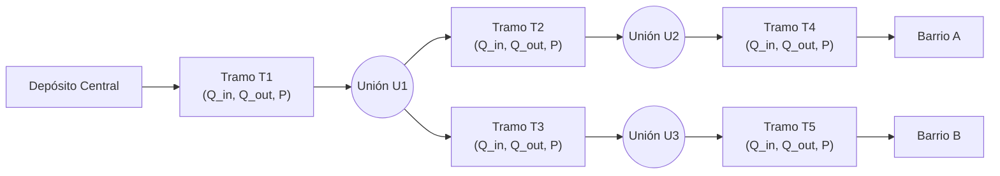
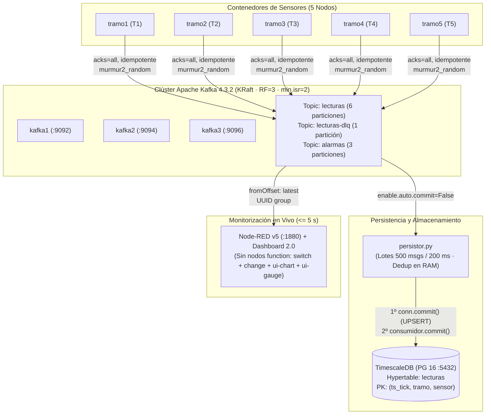

# Red de Distribución de Agua — Sistemas Distribuidos

Simulación y monitorización en tiempo real de una red de distribución de agua con **5 tramos (`T1..T5`)** y **15 sensores** (3 por tramo: `caudal_entrada`, `caudal_salida` y `presion`), transporte tolerante a fallos mediante **Apache Kafka 4.3.2 (KRaft)**, almacenamiento en **TimescaleDB (PostgreSQL 16)** y visualización en vivo en **Node-RED Dashboard 2.0** (100 % libre de nodos `function`).

---

## 1. Topología Física y Sensores (15 sensores)



* **Conservación de caudales en las uniones:**
  * Demanda sinusoidal del Barrio A: $a(t) = 30 + 7{,}5 \sin(\omega t)$
  * Demanda sinusoidal del Barrio B: $b(t) = 30 + 7{,}5 \sin(\omega t + 1{,}6)$
  * Caudales base por tramo: $Q_{T1} = a(t) + b(t)$, $Q_{T2} = Q_{T4} = a(t)$, $Q_{T3} = Q_{T5} = b(t)$.

---

## 2. Diagrama de Arquitectura del Sistema



---

## 3. Guía de Instalación y Puesta en Marcha

### Requisitos previos
* Docker y Docker Compose v2
* Python 3.10+ y Node.js 18+ (con Node-RED instalado)

### Paso 1: Levantar la infraestructura base (Kafka KRaft + TimescaleDB)
```bash
cd ~/Escritorio/sistemas_distribuidos/red_agua
cp -n .env.example .env   # Ajusta tus credenciales en .env si es la primera vez
docker compose up -d
```
Verifica que los 3 brokers (`kafka1`, `kafka2`, `kafka3`), `kafka-ui` (`:8080`) y `timescaledb` (`:5432`) estén `healthy`:
```bash
docker compose ps
```

### Paso 2: Iniciar los 5 nodos de tramos y el persistidor
Puedes lanzarlos de **dos formas equivalentes**:

#### Opción A — Como 5 contenedores independientes en Docker (perfil `nodos`):
```bash
docker compose --profile nodos up -d --build
```
*(Esto levanta los contenedores `tramo1`, `tramo2`, `tramo3`, `tramo4`, `tramo5` y `persistor`).*

#### Opción B — En terminales locales (ideal para depurar y hacer pruebas en directo):
```bash
# Terminal 1: Persistidor Kafka -> TimescaleDB
pruebas/.venv/bin/python persistencia/persistor.py --grupo persistor-vivo

# Terminal 2: Simulador de los 5 tramos (1 tick/s por tramo)
pruebas/.venv/bin/python motor/simulador.py
```

### Paso 3: Levantar el Dashboard en vivo en Node-RED
```bash
(cd nodered && npm install)
node-red -p 1880 -u nodered nodered/flows.json
```
* **Dashboard en vivo:** [http://localhost:1880/dashboard/vivo](http://localhost:1880/dashboard/vivo)
* **Editor de flujos:** [http://localhost:1880](http://localhost:1880)
* **Kafka UI:** [http://localhost:8080](http://localhost:8080)

---

## 4. Ejecución de Tests y Pruebas de Fallos

### Tests automáticos (`pytest`)
```bash
pruebas/.venv/bin/pytest -v tests/
```

### Pruebas de tolerancia a fallos (A–G)
Ver el detalle paso a paso en [pruebas_fallos/GUIA.md](pruebas_fallos/GUIA.md) y las evidencias en `imagenes-doc/`.

### Comprobar latencia extremo a extremo en TimescaleDB ($\le 5\text{ s}$)
```bash
docker exec timescaledb psql -U postgres -d red_agua -c "
SELECT tramo, sensor, valor, ts_real, ts_bd,
       ROUND(EXTRACT(EPOCH FROM (ts_bd - ts_real)) * 1000, 2) AS latencia_ms
FROM lecturas
ORDER BY ts_tick DESC LIMIT 10;"
```
